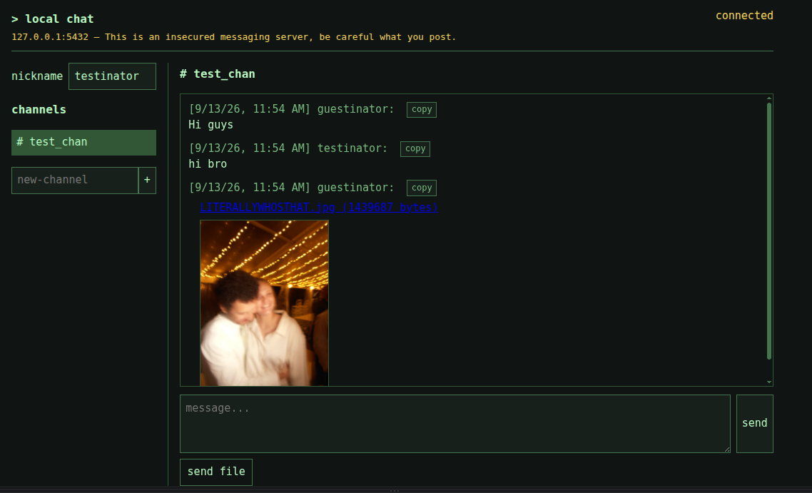

# Local Chat

Local Chat is a small, single-process public chat server. It provides public
channels, multiline messages, browser-local nicknames, realtime updates, and
text/image attachments. It has no accounts, private channels, external
database, or browser-side dependencies.


## Running

Create the environment and install the server dependencies:

```bash
cd /home/skilmartin/code/ai_test
python3 -m venv .venv
.venv/bin/pip install -r requirements.txt
```

Start the server using the deployment settings:

```bash
.venv/bin/python run.py
```

Open the configured host and port in a browser. The default is
<http://127.0.0.1:8000>.

### Data and configuration

The server loads [config.json](./config.json) once at startup. It is a
deployment file and cannot be changed from the chat application. It controls:

- `host` and `port`: the Uvicorn bind address.
- `page_title`: the browser title and displayed site title.
- `warning_text`: the warning shown beside the host and port.
- `max_history`: retained messages per channel.
- `max_channels`: maximum number of channels.
- `max_messages_per_client`: messages allowed per client IP in the rate window.
- `rate_window_seconds`: rolling rate-limit duration.
- `max_attachment_size`: maximum attachment size in bytes.

Messages and channel metadata are stored in the formatted
`chat-data.json` file. Attachments are stored as generated-ID files in
`chat-data-attachments/`. Original attachment bytes are preserved. Deleting a
channel deletes its messages and referenced attachment files. Back up the data
file and attachment directory while the server is stopped.

### Features

- Public channel creation, switching, and two-second hold-to-delete.
- Multiline messages: Enter sends; Ctrl+Enter or Cmd+Enter inserts a newline.
- Browser-local nickname storage.
- SSE-based realtime message delivery and reconnect status.
- Text and small image attachments with previews and downloads.
- Inline error/success notifications and message copy buttons.
- Date-and-time message timestamps.
- No external CDN or frontend package dependency.

This MVP is unauthenticated: everyone who can reach the server can see public
channels, messages, and attachments. It is designed for a single process;
multi-worker or distributed deployment is not supported.

## Developing

### Project structure

- [app.py](./app.py): FastAPI application, configuration validation, JSON
  persistence, channel/message routes, attachment handling, and SSE.
- [run.py](./run.py): loads `config.json` and starts Uvicorn with its host and
  port.
- [config.json](./config.json): static deployment configuration.
- [static/index.html](./static/index.html): page structure and form controls.
- [static/style.css](./static/style.css): terminal-style layout and responsive
  styling.
- [static/script.js](./static/script.js): API calls, DOM rendering, SSE
  subscriptions, keyboard behavior, uploads, and channel interactions.
- [requirements.txt](./requirements.txt): FastAPI, Uvicorn, and multipart form
  parsing dependencies.

### Request flow

1. `run.py` loads and validates `config.json`, then starts Uvicorn.
2. `create_app()` constructs `AppConfig`, `JsonStore`, and `AppState`.
3. The application lifespan loads or creates `chat-data.json`.
4. The browser loads `/`, then fetches `/api/config` and `/api/channels`.
5. Selecting a channel fetches its message history and opens its SSE stream.
6. Sending a message uses JSON for text-only messages or multipart form data
   when an attachment is present.
7. The route validates and persists the message, then publishes it to all
   subscribers for that channel.
8. The browser renders message content with text nodes, never `innerHTML`.

### API endpoints

#### `GET /health`

Returns a liveness response:

```json
{"status": "ok"}
```

#### `GET /api/config`

Returns only browser-safe deployment values:

```json
{
  "page_title": "local chat",
  "warning_text": "This is an insecured messaging server, be careful what you post"
}
```

#### `GET /api/channels`

Returns channel IDs, names, creation times, and retained message counts.

#### `POST /api/channels`

Creates a channel:

```json
{"name": "general"}
```

Names are normalized to lowercase and must match the channel-name pattern in
`app.py`.

#### `DELETE /api/channels/{channel_id}`

Deletes a channel, its messages, and its referenced attachment files. The
browser intentionally requires a two-second hold followed by confirmation
before making this request.

#### `GET /api/channels/{channel_id}/messages`

Returns the retained message history for a channel.

#### `POST /api/channels/{channel_id}/messages`

Text-only messages use JSON:

```json
{
  "nickname": "guest",
  "content": "hello"
}
```

Messages with attachments use `multipart/form-data` with `nickname`,
optional `content`, and one or more `attachment` fields. Attachment-only
messages are supported. The server validates MIME type and configured size,
stores original bytes, and adds metadata to the message.

#### `GET /api/attachments/{attachment_id}`

Downloads an attachment by generated ID. The original filename is used only
as a safe display/download name; it is never used as a filesystem path.

#### `GET /api/channels/{channel_id}/events`

Opens an SSE stream. New messages are sent as `message` events, and periodic
comment frames keep idle connections alive. The frontend reconnects through
the browser's `EventSource` behavior and reloads history when a channel is
selected.

### Backend implementation guide

`AppConfig` owns startup validation for deployment values. `JsonStore` is the
only component that reads or writes persisted chat data and uses a lock plus
atomic replacement writes. Attachment files live beside the JSON file in a
generated-ID directory and are referenced by message metadata.

`AppState` owns transient runtime state: SSE subscriber queues and the
per-client-IP rolling rate limiter. It is not persisted. The route functions
inside `create_app()` translate HTTP requests into store operations and call
`AppState.publish()` after successful message writes.

To change message retention or upload limits, update `config.json`. To change
validation or persistence behavior, inspect `AppConfig`, the Pydantic request
models, and `JsonStore`. To add an endpoint, add a route inside `create_app()`
and reuse the store/state helpers rather than manipulating the JSON document
directly.

### Frontend implementation guide

`index.html` defines the controls and stable element IDs. `style.css` contains
all presentation. `script.js` owns the client state:

- `api()` handles HTTP requests and readable API errors.
- `loadConfig()` applies deployment-controlled title and warning text.
- `loadChannels()` rebuilds the sidebar.
- `selectChannel()` loads history and opens SSE.
- `render()` and `renderAttachment()` safely build message DOM.
- `startDeleteHold()` and `deleteChannel()` implement protected deletion.
- The form handlers create channels and send text or multipart messages.

When rendering user content, continue using `textContent` or text nodes.
Attachments should remain download-first and previews must not use
`innerHTML`.
